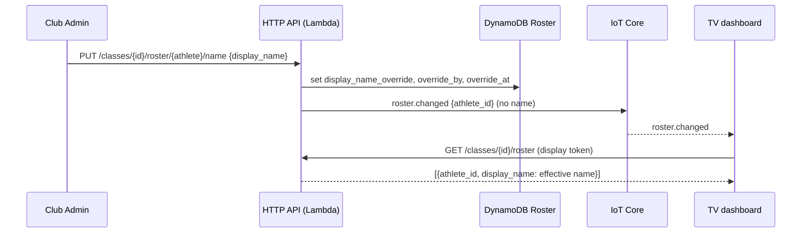
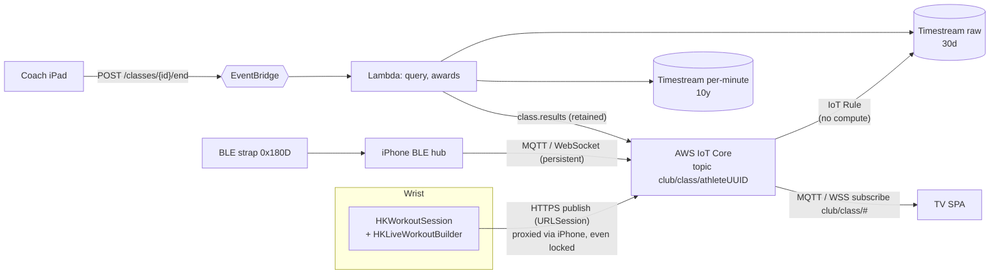

# LM Club: Architecture, Business Rules & Privacy Constraints

> **Source of truth.** This file is the single reference for *what the product must and must not do*
> (§1 business, §2 RBAC, §3 privacy: **normative**) and *how the stack implements it* (§4 onward:
> descriptive). If code, a schema or a ticket contradicts §1-3, the code is wrong. A rule changes only by
> editing this file in the same PR as the code that enforces it. **MUST / MUST NOT** are binding; every rule
> names its enforcement point and whether an automated test covers it, so "documented" is never confused
> with "enforced".

Real-time B2B fitness gamification: athletes' heart rate -> AWS IoT Core -> TV dashboard.

| § | Topic |
|---|---|
| 1 | B2B monetization strategy |
| 2 | Roles, RBAC and the Admin Override |
| 3 | Strict Privacy by Design |
| 4 | System design: Watch -> AWS IoT -> TV |
| 5 | Security model |
| 6 | Contracts |
| 7 | Verified vs not verified |
| 8 | Known risks and next steps |
| 9 | Running it |

Monorepo layout:

| Dir | What | Verify |
|---|---|---|
| [`contracts/`](../contracts) | JSON Schemas = single source of truth; generated TS types, zones, topic helpers, shared fixtures | `npm test` |
| [`backend-aws/`](../backend-aws) | AWS CDK (TypeScript): IoT Core, Timestream, DynamoDB TTL, EventBridge, Lambdas, Cognito, HTTP API | `npm test && npx cdk synth` |
| [`ios-app/`](../ios-app) | Swift package (Clean Architecture) + iOS/watchOS composition roots | `swift test` |
| [`tv-dashboard/`](../tv-dashboard) | React/TS SPA, MQTT-over-WebSocket consumer | `npm test && npm run build` |

Each dir except `contracts/` consumes `contracts/` as a local dependency (or, for Swift, by decoding the same
fixtures in tests), so a contract change that breaks any layer fails that layer's tests.

---

## 1. B2B monetization strategy

**The customer is the club. The athlete is never charged.**

| Party | Pays | Gets |
|---|---|---|
| **Club** (gym / boutique studio) | Monthly SaaS subscription via Stripe | TV dashboard, white-label branding, coach/iPad tooling, live gamification, class results, Admin Override |
| **Athlete** | Nothing, ever | Free iOS/watchOS app: join a class, see own effort live; optional account for history, badges, Apple Health sync |

**Why this shape (avoiding B2C cannibalization).** If the athlete app were useful on its own, athletes would
have no reason to attend a club that pays for LM Club, and the club would have no reason to pay. The product is
therefore built so the athlete app is **a client of the club's product, not a competitor to it**:

| # | Rule | Enforcement | Status |
|---|---|---|---|
| B1 | The athlete app MUST NOT contain a paywall, In-App Purchase, premium tier or ads. | No purchase code exists in `ios-app/`; review gate. | Policy (no automated test) |
| B2 | The athlete app MUST have **no standalone value**: the only way to use it is to join a *live class of a paying club* with its PIN. No solo workout mode; athletes cannot create classes. | `POST /join` requires a live PIN ([`join.ts`](../backend-aws/src/app/join.ts)); class creation is staff-only; the public route set is asserted in [`stack.test.ts`](../backend-aws/test/stack.test.ts). | Enforced + tested |
| B3 | A club can create classes **only while its subscription is `active` or `trialing`**; otherwise `402`. One choke point: `createClass` ([`classes.ts`](../backend-aws/src/handlers/classes.ts)). | `club.subscription_status` | Enforced; **not covered by an automated test**; the Stripe webhook that maintains the field is **not built** |
| B4 | Everything that creates the "wow" (TV, podium, per-workout gamification, branding, awards) lives on the club side of the paywall. Athlete-side value (history, badges) is free but only accrues from classes at paying clubs, so it retains athletes *to the club*. | Architecture | By design |
| B5 | Athlete data MUST NOT be monetized (no sale, no sharing, no ads). See P6. | §3 | Policy |
| B6 | **BYOD**: no hardware sales; Apple Watch or any standard BLE heart-rate strap (GATT 0x180D). | `ios-app` BLE hub | By design |

Behaviour on lapse: a class already live keeps running (so a billing glitch never kills a session in front of
30 people); **new** classes are blocked immediately (`past_due`/`canceled` are not allowed; a grace period is a
product decision not yet encoded). Joining and the TV are not independently gated, so there is exactly one
place to enforce billing.

Not decided / not built: pricing tiers (per-seat, per-class, per-location), the Stripe webhook, invoicing.
The athlete app sells nothing, so no In-App Purchase is involved; the club buys on the web. Confirm this against
the current App Review Guidelines (business-services clause) before submission.

## 2. Roles and RBAC

### 2.1 Roles

| Role | Surface | Identity mechanism |
|---|---|---|
| **Athlete: Guest** | iOS/watchOS | None. 4-digit PIN + a display name. Class-scoped pseudonym UUID. |
| **Athlete: Authenticated** | iOS/watchOS | Cognito user (email now; Apple/Google federation pending). Gets history/badges/Health sync. |
| **Coach** | iPadOS (API ready; iPad app not built yet) | Cognito group `coach`; creates classes with a `workout_type` (`hyrox`, `indoor_cycling`, `hiit`) that tailors the TV UI and award rules. |
| **Club Admin** | Web/admin (API ready; no admin UI built yet) | Cognito group `club_admin`; everything a Coach can do **plus** branding and **Admin Override**. |
| *TV display (system principal)* | Browser | Class-scoped display token minted when a class is created. Read-only. |

Staff identity: Cognito JWT with `cognito:groups` and `custom:club_id`. `custom:club_id` is immutable and **not
writable by app clients** (`writeAttributes` is email-only), so a self-signed-up athlete can never become staff
or join a club's staff. Group membership is assigned by an operator out-of-band (no onboarding flow built yet).

### 2.2 Permission matrix

| Capability (endpoint) | Guest | Auth. athlete | Coach | Club Admin | TV |
|---|:-:|:-:|:-:|:-:|:-:|
| Join a class (`POST /join`, public, throttled, PIN-locked) | ✓ | ✓ | | | |
| Join + save history (`POST /join/authenticated`) | | ✓ | | | |
| Create class / rotate PIN / end class (`POST /classes`, `/pin`, `/end`) | | | ✓ | ✓ | |
| Edit club branding (`PUT /club/branding`) | | | | **✓** | |
| **Override an athlete's display name** (`PUT /classes/{id}/roster/{athlete}/name`) | | | | **✓** | |
| Read class + roster (`GET /classes/{id}`, `/roster`) | | | | | ✓ (own class) |
| MQTT: publish telemetry | own topic only | own topic only | | | ✗ |
| MQTT: subscribe | `_control/events` only | `_control/events` only | | | `club/class/#` |

Binding rules:

| # | Rule | Enforcement | Tested |
|---|---|---|---|
| R1 | **Tenant isolation**: the club is taken from the verified token, never from the request; a class of another club answers `404` (no existence oracle). | `staffFrom()`, `ownedClass()` | Partly (policy/ARN scoping in [`security.test.ts`](../backend-aws/test/security.test.ts)) |
| R2 | Coaches MUST NOT edit branding or athlete names; only `club_admin`. | `staffFrom(event, ['club_admin'])` in [`admin.ts`](../backend-aws/src/handlers/admin.ts) | Not directly |
| R3 | An athlete may publish **only** to its own `club/class/{uuid}` topic and cannot read other athletes' telemetry; the TV cannot publish. | IoT custom authorizer ([`authorizer.ts`](../backend-aws/src/handlers/authorizer.ts)) | Yes |
| R4 | Tokens are class-scoped and expire (athlete 3 h, TV 6 h); a token for class A is useless for class B. | `verifyToken`, `requireRoleToken` | Yes |

### 2.3 Admin Override

**Purpose.** Guests choose their own display name, which is shown on a public screen. When someone registers as
`xX_mike_Xx` (or something inappropriate), the Club Admin corrects what the TV shows without touching anything
else.

| # | Rule | Enforcement |
|---|---|---|
| O1 | Only a **Club Admin** may override. Coaches may not. | `club_admin` group check |
| O2 | Scope is one athlete in one class **of the admin's own club**. | `cls.club_id === staff.clubId`, else `404` |
| O3 | It changes **only the name shown on the TV**: effective name = `display_name_override ?? display_name`. The athlete's original `display_name` is preserved, and `{"display_name": null}` clears the override. | [`mappers.ts`](../backend-aws/src/domain/mappers.ts), tested in [`mappers.test.ts`](../backend-aws/test/mappers.test.ts) |
| O4 | It grants **no access** to account id, e-mail, auth state, heart-rate data or the UUID link. The TV projection (`RosterEntry`) never contains the account link. | Contract + test |
| O5 | The override passes the same sanitizer as athlete names (NFKC, control/bidi/zero-width stripped, 1-24 code points), so an admin cannot inject layout-spoofing text either. | `sanitizeDisplayName`, tested |
| O6 | Audited: `override_by` (admin subject) and `override_at` are stored on the roster row. **Only the latest override is kept** (no history), and the row expires with the 90-day roster TTL. | Roster record |
| O7 | The name **never travels over IoT Core**. IoT carries only a PII-free `roster.changed {athlete_id}` signal; the TV re-fetches names over authenticated REST (see P3). | Contract (`additionalProperties:false`), test |
| O8 | Lifetime is **per class**. Pseudonyms and rosters are per class, so an override does not carry to the next class. | Data model |



## 3. Strict Privacy by Design

### 3.1 Rules

| # | Rule | Enforcement | Tested |
|---|---|---|---|
| P1 | **Zero PII in the real-time layer.** Topics, MQTT/HTTPS payloads, control events, EventBridge events and results contain only: club slug, class UUID, athlete UUID, `bpm`, `effort_pct`, `seq`, `source`, `workout_type`, timestamps. **Never** names, e-mails, account ids, age/DOB, max HR or IPs. | `additionalProperties:false` on `heart-rate-payload` and `control-message`; the IoT rule `SELECT` is a whitelist (`bpm, effort_pct, seq, source`) | Yes: contract tests reject extra/PII fields; iOS test asserts the encoder emits exactly the contract keys; join test asserts no name is published |
| P2 | **Zero PII in Timestream.** Dimensions are `club_id`, `class_id`, `athlete_id` (UUID); measures are numeric. Both tables (raw and per-minute). | `telemetry.ts`, `timestream.ts` | Partly: rule dimensions asserted in `stack.test.ts` |
| P3 | **Identity is only an opaque UUID; UUID -> person is resolved on the presentation layer.** The mapping lives in the DynamoDB `Roster` (class-scoped). The TV obtains it over authenticated REST (`GET /classes/{id}/roster`, display token) and joins UUID -> name **in the browser at render time**. Results payloads carry UUIDs only. | `RosterEntry` projection; `TelemetryStore` | Yes |
| P4 | **"Encrypted UUID"** = an opaque pseudonym (random for guests; HMAC(secret, class, account) for signed-in athletes, so unlinkable across classes without the server secret) sent only over TLS 1.2+ and stored under a customer-managed KMS key (Timestream and every DynamoDB table). | `pseudonymFor`, CDK | Yes (stable, class-scoped) |
| P5 | **Sensitive profile data stays on the device.** Age/DOB (read from HealthKit) and max HR never leave the phone/watch; only the derived `effort_pct` is sent. | `MaxHeartRate`, `StreamHeartRateUseCase` | Yes |
| P6 | **No sale or third-party sharing; HealthKit data is used only for the class experience** (App Store Review Guideline 5.1.3). No ad/analytics SDKs: the Swift package has **zero third-party dependencies** and the TV ships only React + mqtt.js. Health writes (Apple Fitness) are local and optional (`saveToHealth`). | Dependency policy; usage strings in `project.yml` | Policy |
| P7 | **Guests are account-free**: a guest leaves only a roster row (display name + UUID) that expires in 90 days. | Data model, Roster TTL | Partly (guest path tested; TTL not asserted) |
| P8 | **Logs never become a PII store**: handlers log error class names only; log groups expire in 30 days. | `http.ts`, CDK | Partly (30-day retention asserted; log content not) |

> Why not encrypt the UUID at the application layer? The topic must be readable by IoT for policy matching and
> routing, and anyone allowed to subscribe sees the same identifier either way, so it would add complexity
> without confidentiality. TLS + KMS is the control. If you require application-layer encryption, that is a
> product decision to record here.

### 3.2 Where each kind of data lives

| Store | Contains | PII? | Retention |
|---|---|---|---|
| IoT Core (topics, payloads, control events) | UUIDs, bpm, effort %, workout type | **No** | Transient, except the retained `class.results` (UUIDs only; kept until replaced) |
| Timestream raw | per-second beats keyed by UUID | **No** | **30 days** (auto-expiry) |
| Timestream per-minute aggregates | per-minute averages keyed by UUID | **No** | 10 years |
| EventBridge | `club_id, class_id, workout_type, ended_at` | **No** | Transient |
| DynamoDB `Roster` | UUID <-> display name, override, account id, provider | **Yes** | **90 days** (TTL) |
| DynamoDB `History` | account id <-> per-class stats and badges (authenticated only) | **Yes** | Until account deletion (**deletion endpoint not built**) |
| DynamoDB `Pins` | PIN -> class (15 min); source IP counters for brute-force lockout (5 min) | IPs | 15 min / 5 min (+ lazy TTL sweep) |
| Cognito | e-mail, provider subject | **Yes** | Account lifetime |
| CloudWatch Logs | error class names, no payloads | No | 30 days |
| TV browser memory | names + live metrics | Yes (display only) | Tab lifetime; nothing persisted |

Data lifecycle: raw per-second beats auto-expire after 30 days; before that, class completion writes per-minute
aggregates into a long-retention table, so there is no compaction cron to fail
(`class-completed.ts`, `RAW_RETENTION_DAYS`).

### 3.3 What "anonymous" does and does not mean (read before any compliance conversation)

* **This is pseudonymization, not anonymization.** While a `Roster` row exists (<= 90 days, or indefinitely for
  an authenticated athlete's `History`), heart-rate data is re-identifiable by the operator. Heart rate is
  health data (GDPR Art. 9 special category): plan for explicit consent, a DPA with each club, and a DPIA.
* For guests, once the roster row expires the retained aggregates can no longer be linked to a person.
* **Display names are PII** (people type real names). They exist in the Roster, in REST responses and on the
  TV screen, **never on IoT Core**.
* Erasure/export (GDPR Art. 17/20) endpoints for authenticated athletes are **not built**; Timestream rows are
  not individually deleted: erasure works by deleting the Roster/History link.

## 4. System design: Watch -> AWS IoT -> TV



* **Why the watch publishes directly.** A workout session is the only thing that keeps a watchOS app executing
  with the wrist down. Publishing from the watch removes the phone as a single point of failure (iOS kills
  backgrounded apps; the watch does not depend on it). When the watch has no Wi-Fi/cellular, watchOS routes
  `URLSession` traffic through the paired iPhone's connection automatically, **even with the phone locked**.
* **Why IoT Core + WebSockets.** Fan-out is the broker's job: one publish reaches the TV (and any other
  subscriber) with no servers to scale. Topic hierarchy `clubID/classID/athleteUUID` makes authorisation a
  path-prefix policy and tenancy isolation structural. Browsers speak MQTT over WSS natively.
* **Why the IoT Rule writes straight into Timestream.** No compute in the hot path = nothing to throttle,
  scale or pay for per frame. The rule's `WHERE` clause drops impossible readings; timestamps use broker
  arrival time because device clocks are untrusted.
* **Why decouple rendering.** The TV keeps a mutable `TelemetryStore`; the UI reads immutable snapshots at
  most once per `requestAnimationFrame` (60 fps ceiling) regardless of message rate.

### ⚠ Deviation from the brief: the watch cannot use an MQTT socket

Apple [TN3135](https://developer.apple.com/documentation/technotes/tn3135-low-level-networking-on-watchos)
classifies `URLSessionWebSocketTask`, `NWConnection` and sockets as *low-level networking*, which watchOS
**blocks** except for audio-streaming and CallKit VoIP apps. A workout app is neither. (The simulator always
allows it, so this only fails on a real watch.) Therefore:

* **watchOS** publishes with **IoT Core's HTTPS publish** (`POST /topics/{topic}?qos=0`) via plain `URLSession`:
  high-level, allowed, iPhone-proxied. Cost: one request per frame, so cadence defaults to 2 s there.
* **iPhone/iPad** keeps the persistent **MQTT 3.1.1 over WebSocket** publisher (no such restriction).
* Both implement the same `TelemetryPublisher` port, selected in the composition root; nothing else changes.

## 5. Security model

| Actor | How it authenticates | What IoT policy it gets |
|---|---|---|
| Athlete (guest or signed in) | `POST /join` (PIN) -> backend mints a 3 h HS256 token | `Publish` **only** `club/class/{its UUID}`; `Subscribe/Receive` **only** `club/class/_control/events`; `Connect` only as its own UUID |
| TV | class-scoped display token from `POST /classes` (URL fragment, scrubbed after read) | read-only `club/class/#`; cannot publish |
| Coach / Club Admin | Cognito JWT, groups `coach` / `club_admin`, `custom:club_id` bound by admins | n/a (REST only) |

* An **IoT custom authorizer** (Lambda) verifies the token and returns a per-principal policy; no long-lived
  device certificates, no Cognito Identity Pool wildcard policies. Athletes cannot read each other's telemetry.
* `_control/events` is 4 levels deep: the telemetry rule filter `+/+/+` can never ingest server events. Every
  athlete in a class may read it, which is safe because it carries UUIDs only (P1).
* PINs: 4 digits is a 10 k space, so: per-IP lockout (10 failures / 5 min), route throttle (10 rps), identical
  404 for wrong vs expired, TTL 15 min **plus** an explicit `expires_at` check (DynamoDB TTL deletes lazily).
* Cross-tenant: every staff endpoint derives `club_id` from the verified token, never from the request.
* Timestream QL has no bind parameters for ad-hoc queries, so ids are validated against strict
  slug/UUID patterns before interpolation (`assertIds`, unit-tested).

## 6. Contracts (`contracts/schemas/`)

`heart-rate-payload`, `class-session` (+ `branding`), `athlete-identity`, `roster-entry`, `class-results`,
`control-message` (`roster.changed` (UUID only) / `class.state` / `class.results`), `join-receipt`; plus `zones.json`
(thresholds, colours, points) with cross-language test vectors. Workflow: edit schema ->
`npm run generate` (types) -> update fixtures -> all four test suites tell you what broke.
The TV deliberately uses a hand-written guard for the 1 Hz hot path (Ajv needs `unsafe-eval`, incompatible with
a strict CSP); a test keeps it consistent with the schema.

## 7. Verified vs not verified

Verified locally: 15 contract + 33 backend + 14 TV tests; `cdk synth` (CloudFormation validation clean apart
from the Timestream notice below); TV production build; `swift test` (23 tests); every Swift layer compiles for
iOS and watchOS SDKs (incl. `WorkoutManager`, Swift 6 mode); both app composition roots typecheck.

**Not verified (needs a deployed stack / real devices), in order of risk:**
1. IoT custom-authorizer wiring: token via query string for WSS **and** HTTPS publish, unsigned authorizer;
   HTTPS topic path encoding (`%2F`). First thing to test after `cdk deploy`.
2. Real-watch run: HTTPS publish through the proxied iPhone with phone locked, and battery at 2 s cadence.
3. `project.yml` (XcodeGen) has not been generated/built; fill in team + bundle ids.
4. Sign in with Apple / Google federation: Cognito has email sign-in only; add IdPs when credentials exist.

## 8. Known risks and next steps

* **Timestream for LiveAnalytics is in maintenance mode since 2025-06-20** (CloudFormation reports it) and is
  closed to new customers. The brief mandates Timestream; the code isolates it behind `TelemetryRepository`, and
  the only non-portable piece is the IoT Rule's native action. If your account cannot create it, the clean
  swap is Timestream for **InfluxDB** (IoT Rule -> Kinesis/Firehose or a thin writer Lambda) or
  DynamoDB with TTL + per-minute rollups; the Lambda domain logic (`computeResults`) is unaffected.
* Coach forgets to end a class -> no aggregates before the 30-day expiry. Add a scheduled sweeper that emits
  `ClassCompleted` for `live` classes older than N hours.
* Stripe: `subscription_status` gates class creation (402) but the webhook that maintains it is not built, and
  the 402 path has no automated test (§1, B3).
* Privacy/compliance gaps (§3.3): account erasure + data export endpoints, consent capture for health data, DPA
  template for clubs and a DPIA are not built/written.
* Admin Override keeps only the latest override (no audit history), and the Coach iPad app and Club Admin web UI
  are not built yet (the APIs are).
* Token refresh: TV/athlete tokens are 6 h / 3 h and the authorizer disconnects at expiry; add a refresh endpoint.
* JWT signing key rotation: key is fetched once per Lambda container; add dual-key verification before rotating.
* Hardening: WAF on the HTTP API, CloudWatch alarms (rule errors, DLQ depth, authorizer denials), CORS
  `tvOrigin` context (defaults to `*`; set it per stage: `cdk deploy -c tvOrigin=https://tv.example.com`).

## 9. Running it

```bash
(cd contracts && npm i && npm test)
(cd backend-aws && npm i && npm test && npx cdk deploy -c stage=dev -c tvOrigin=https://tv.example.com)
(cd tv-dashboard && npm i && cp .env.example .env && npm run dev)   # open /?class=<uuid>#t=<display token>
(cd ios-app && swift test)
```
Bootstrap: create a `clubs` item (`subscription_status: active`), a Cognito user with `custom:club_id` in group
`club_admin`/`coach`, then `POST /classes` returns the `tv_token` and the 4-digit PIN.
